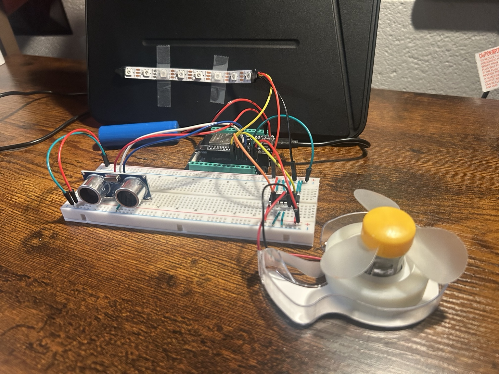

# Ultrasonic Distance-Based Motor Control System

[Watch the demonstration video](StopLight%20Video.mp4)

An ESP32-based circuit designed to practice ultrasonic distance sensing, DC motor control, and NeoPixel LED status indication in preparation for a robotics project.

## Project Overview

This project was developed as a hands-on introduction to integrating sensors, microcontrollers, and motor drivers for robotics applications.

Using an HC-SR04 ultrasonic sensor, the ESP32 measures the distance to nearby objects and determines the appropriate motor response. An L293D motor driver controls a DC motor with an attached fan, while a NeoPixel LED strip provides color-coded visual feedback.

The circuit demonstrates three operating states: forward, reverse, and stop. The project provided practical experience with hardware connections, embedded programming, and motor control concepts used in robotics.

## Hardware Components

- **ESP32 Microcontroller** — Processes sensor measurements and controls system outputs.
- **HC-SR04 Ultrasonic Sensor** — Measures distance using ultrasonic pulses.
- **L293D Motor Driver IC** — Controls the DC motor's direction and operation.
- **DC Motor with Fan Attachment** — Demonstrates forward and reverse motor rotation.
- **NeoPixel LED Strip** — Displays the current operating state using programmable, individually addressable LEDs.
- **Breadboard and Jumper Wires** — Connect the electronic components.
- **Power Supply** — Provides power to the circuit.

## System Operation

The ESP32 processes distance measurements from the ultrasonic sensor and selects a motor operating state based on programmed conditions.

| LED Color | Operating State | Motor Response |
|---|---|---|
| 🟢 Green | Forward | Motor rotates normally |
| 🟡 Yellow | Reverse | Motor rotates in the opposite direction |
| 🔴 Red | Stop | Motor stops rotating |

### Ultrasonic Distance Measurement

The HC-SR04 sensor transmits an ultrasonic pulse and measures the time required for the reflected signal to return.

Distance is calculated using:

**Distance = (Echo Time × Speed of Sound) / 2**

The ESP32 uses these measurements to determine the appropriate motor response.

### Motor Control

The L293D dual H-bridge motor driver allows the ESP32 to control the motor's direction through digital control signals.

The motor responds to the programmed distance conditions by rotating forward, reversing direction, or stopping.

### NeoPixel LED Status Indication

The NeoPixel LED strip provides visual feedback corresponding to the motor's current operating state. The ESP32 controls the strip's color to indicate whether the motor is rotating forward, reversing, or stopped.

This provides a simple way to observe the system's behavior and verify that the programmed motor states are functioning correctly.

## Software Structure

The circuit was programmed using the Arduino IDE and C/C++ for the ESP32.

The program is organized into seven Arduino source files:

| File | Purpose |
|---|---|
| `Rudisel_Paxton_MP04.ino` | Main program and system control |
| `startup.ino` | System initialization |
| `readSensorData.ino` | Ultrasonic sensor measurements |
| `GoState.ino` | Forward motor operation |
| `ReverseState.ino` | Reverse motor operation |
| `StopState.ino` | Motor stop operation |
| `OffState.ino` | Additional off-state functionality |

Separating the code into individual files helps organize the system's control logic and simplifies troubleshooting.

## Project Demonstration

The completed circuit demonstrates three motor operating states in response to ultrasonic distance measurements.

- **Green — Forward:** Motor rotates in its normal direction.
- **Yellow — Reverse:** Motor rotates in the opposite direction.
- **Red — Stop:** Motor stops rotating.

## Skills Practiced

- ESP32 microcontroller programming
- C/C++ programming using Arduino IDE
- Ultrasonic sensor integration
- L293D H-bridge motor driver implementation
- DC motor direction control
- NeoPixel LED programming
- Breadboard circuit assembly
- Hardware and software troubleshooting
- State-based programming

## Project Purpose

This circuit served as a preparatory exercise for a larger robotics project. It introduced fundamental concepts in sensor-based decision-making, motor control, and embedded system integration that could be applied to the development and programming of a mobile robot.

---

*Developed as part of hands-on robotics preparation at Rose-Hulman Institute of Technology.*
